# How the Multimodal Knowledge Engine Works

A personal knowledge engine that turns your sources into structured, searchable knowledge. It
began with Instagram Reels, which is what the rest of this guide still describes while the project
is generalised to documents, web pages, images, and audio.

This document has two parts:

- **[Part 1 — Technical](#part-1--technical)** — the architecture, the pipeline, and why it is built this way.
- **[Part 2 — Using the app](#part-2--using-the-app)** — what each screen does and how to drive it.

---

## The one principle everything follows

> Process each Reel **once**, turn it into structured multimodal knowledge, index that knowledge, and
> let the reasoning layer operate over the knowledge base — never ask the final model to rediscover
> facts from raw video every time you have a question.

A second principle follows from the first, and shapes almost every design decision below:

> **Every fact must be traceable to its source.** A value that cannot be attributed to on-screen
> text, speech, or something visible in the frames is either tagged as inferred or not recorded.

---

# Part 1 — Technical

## 1.1 The four layers

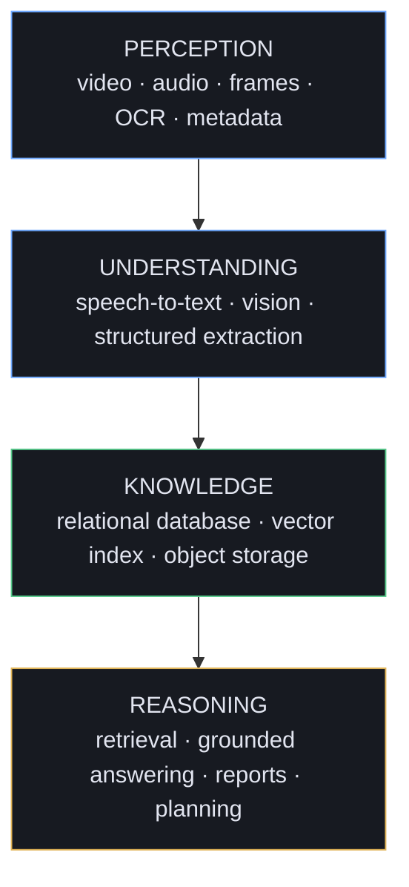

Each layer is replaceable without touching the others. That separation is what lets the whole system
run with **no API key and no model weights** on its local defaults, and upgrade to real models purely
through configuration.

---

## 1.2 End-to-end pipeline

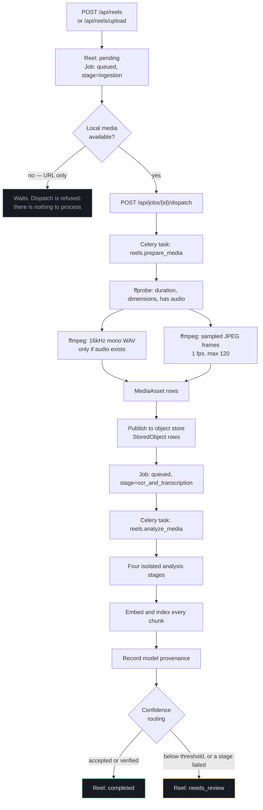

**Nothing is scraped from Instagram.** A submitted URL is recorded as a reference; media enters the
system only when the user uploads it. That is a deliberate policy boundary, not a missing feature.

The HTTP request never runs the pipeline. It writes a durable `ProcessingJob` and returns `202`;
Celery workers claim the job later. That job row is the handoff boundary between the API and the
workers.

---

## 1.3 The analysis stage — four stages that fail independently

This is the most important implementation detail in the system.

```mermaid
flowchart LR
    A["Audio + frames"] --> T["1 · Transcription"]
    T --> O["2 · OCR"]
    O --> V["3 · Vision"]
    V --> X["4 · Extraction"]
    X --> Y["Structured records"]

    T -.->|"fails → empty transcript"| O
    O -.->|"fails → empty OCR text"| V
    V -.->|"fails → try fallback provider"| X
    X -.->|"fails → keep previous knowledge"| Y

    style T fill:#171a21,stroke:#6ea8fe,color:#e2e5f0
    style O fill:#171a21,stroke:#6ea8fe,color:#e2e5f0
    style V fill:#171a21,stroke:#6ea8fe,color:#e2e5f0
    style X fill:#171a21,stroke:#6ea8fe,color:#e2e5f0
```

Each stage is wrapped so a provider exception cannot abort the run:

| Stage fails | What still happens |
|---|---|
| **Transcription** | OCR, vision, and extraction all run. A Reel with perfect on-screen text is not discarded because Whisper broke. |
| **OCR** | The transcript survives and extraction runs on speech plus vision. |
| **Vision** | A fallback provider is tried first. If that also fails, extraction still runs on OCR and transcript evidence. |
| **Extraction** | **Previous knowledge is left intact.** Erasing a good earlier run because a later one broke would be worse than a stale record. |

Two outcomes are deliberately distinguished:

- **`skipped`** — the stage never ran, and that is correct. A silent Reel skips transcription; that is
  not a fault, and it is excluded from failure-rate maths.
- **`failed`** — the stage ran and broke. Any failed stage sends the Reel to review regardless of how
  confident the surviving extraction was, because the knowledge now rests on partial evidence.

Every attempt writes a `StageMetric` row — status, duration, items processed, model, error — appended
rather than overwritten, so a retry's improvement over the previous run stays visible.

---

## 1.4 Evidence and provenance

Every extracted field carries a tag naming where it came from:

| Tag | Meaning |
|---|---|
| `visual` | Seen in the sampled frames |
| `ocr` | Read from on-screen text |
| `transcript` | Spoken aloud |
| `metadata` | From the Reel record itself |
| `inferred` | Concluded rather than observed |

`inferred` is the one to distrust, and the interface renders it deliberately weaker. The tags live in
the record's `data.evidence` map, so no schema change was needed to carry them.

**The silent-video case** is what this design exists for:

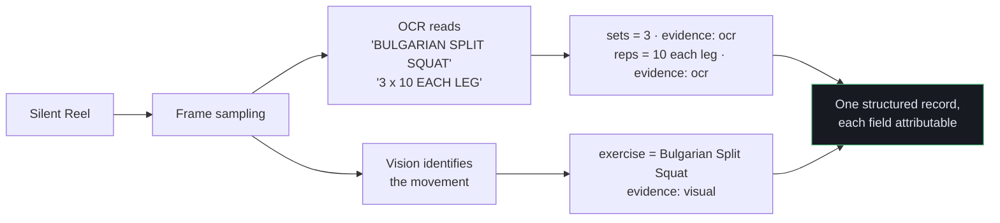

Separately, a `ProcessingProvenance` row records the **model set that produced the knowledge** —
transcription model, vision model, embedding model, OCR and extraction providers, and the extraction
prompt version. It is built by reading back what the run actually persisted, not from configuration
as it stands when someone later inspects it. Without this, an evaluation result cannot be attributed
to the setup that produced it.

---

## 1.5 Confidence routing

Three tiers rather than one threshold:

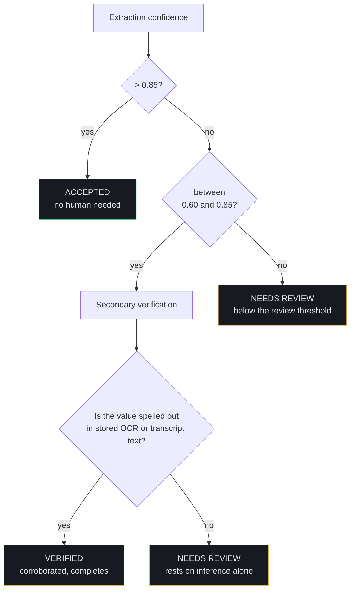

The middle tier implements the cheapest honest verification strategy: check mid-confidence values
against the literal OCR and transcript text already stored. A value spelled out on screen or spoken
aloud is corroborated; one resting on inference alone goes to a human. Running a second, stronger
model is the natural upgrade and fits the same interface.

The decision **and its reason** are written to the job event history, so a routing outcome can be
explained after the fact rather than inferred from the final status.

Thresholds: `AUTO_ACCEPT_CONFIDENCE` (0.85) and `AUTO_REVIEW_CONFIDENCE` (0.60).

---

## 1.6 Embedding and indexing

Each modality is embedded as its **own chunk**, so a retrieval hit can be attributed to the evidence
that produced it rather than to the Reel as an opaque blob:

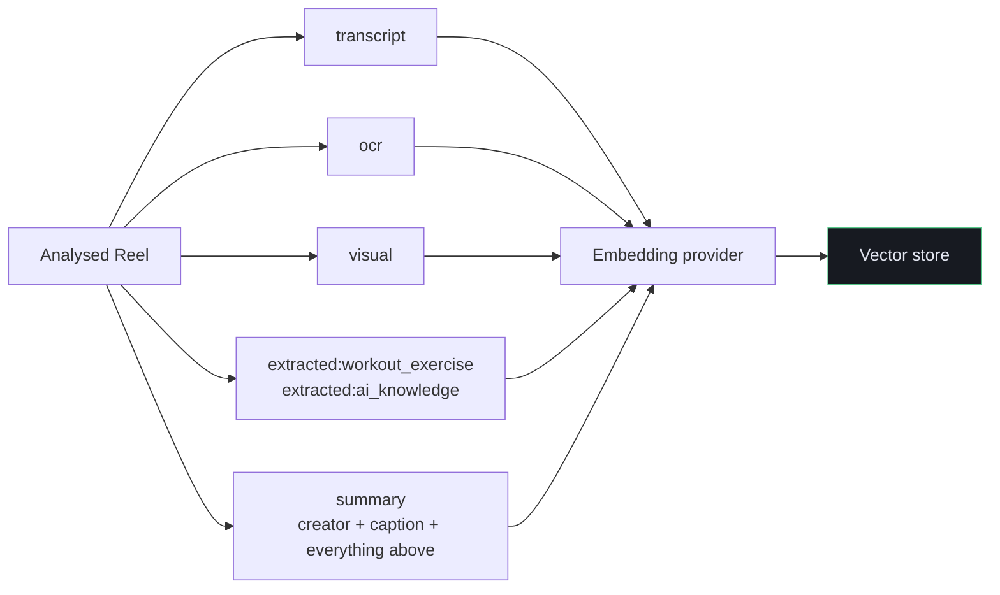

Keys are identical across backends, so moving from the relational store to Qdrant does not rewrite
them. The `summary` chunk doubles as the near-duplicate signal: two Reels whose summary vectors
exceed `DUPLICATE_SIMILARITY_THRESHOLD` (0.92) are reported as near-duplicates. Exact re-uploads are
already blocked at ingestion by URL and SHA-256 media hash; this catches the same content saved from
a different post or re-encoded.

---

## 1.7 Retrieval

Three modes over the same evidence:

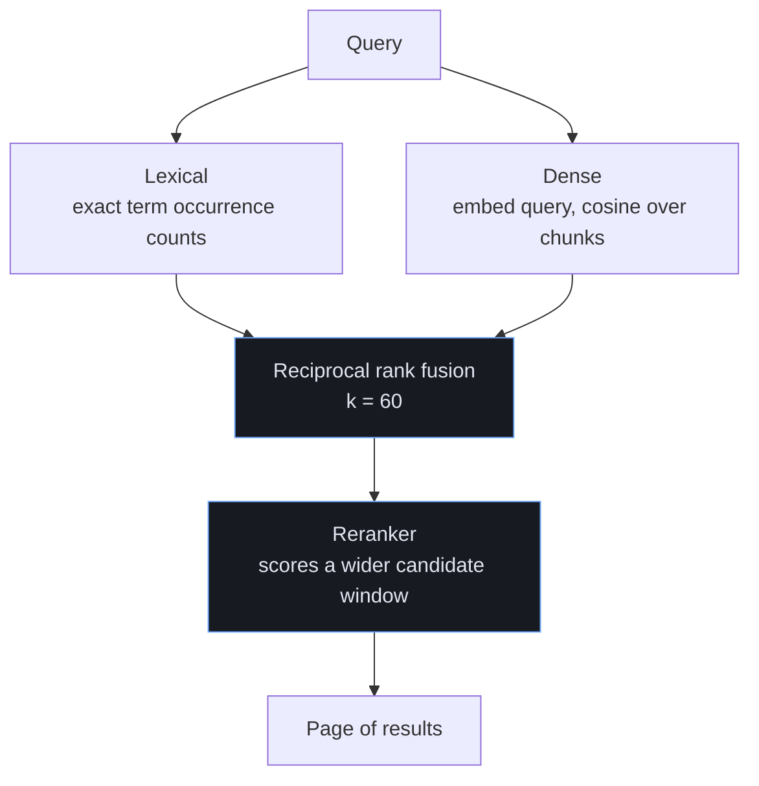

**Why rank fusion rather than adding scores:** lexical occurrence counts and cosine similarities are
not on a comparable scale. Only their *orderings* can be combined meaningfully.

**Why the reranker over-fetches:** its whole value is promoting something the earlier stages ranked
just below the cut, so it scores `RERANK_CANDIDATES` (30) candidates before trimming to the requested
page size.

Results can be narrowed by `content_type`, `creator`, and `topic`. Topics come from extracted
knowledge, so a filter matches what analysis actually found rather than a free-text tag. When a
filter is active, dense retrieval over-fetches so post-filtering cannot empty the page.

| Mode | Best for |
|---|---|
| `lexical` | Exact technical strings — `QLoRA`, `BM25`, `Qdrant` |
| `semantic` | Meaning, when you don't know the exact wording |
| `hybrid` | The default — both, fused then reranked |

---

## 1.8 Grounded answering

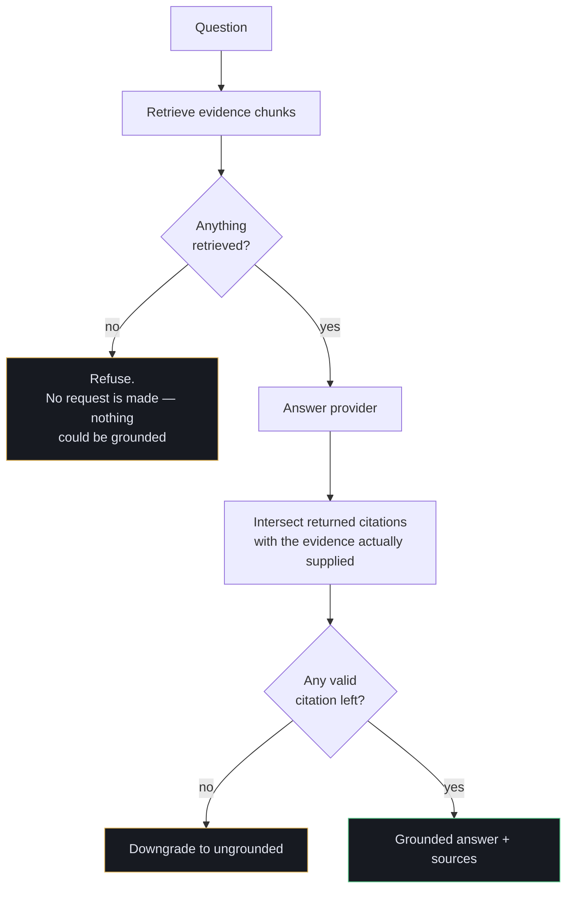

Grounding is enforced **structurally, not by prompt alone**. Three mechanisms:

1. Retrieved evidence is the only material supplied.
2. The prompt forbids outside knowledge.
3. The citations the model returns are intersected with the evidence that was passed in — a Reel id
   the retriever never produced is **dropped**, and an answer left with no valid citation is
   downgraded to ungrounded.

**Reports work the same way in reverse.** Aggregates are computed in the database first, and only
those counts are sent for narration — the model never sees the Reels themselves, so report cost stays
flat as a collection grows.

---

## 1.9 Storage: working files versus durable objects

FFmpeg, OCR, and the vision model all need real local files, so the object store is **not** a
drop-in replacement for the media directory:

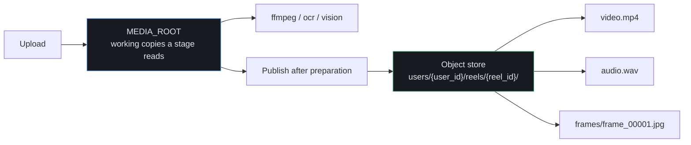

- **S3/MinIO** issues presigned URLs bounded by `SIGNED_URL_TTL_SECONDS`.
- **The local backend** returns no signed URL rather than pretending; the API streams those objects
  through its own ownership check instead. An object is never reachable without authorization on
  either backend.
- Publication is idempotent — republishing replaces prior records rather than accumulating entries
  pointing at frames a newer run has overwritten.

---

## 1.10 Provider abstraction

Seven contracts, each with a local default and an upgrade path. **Every default runs with no API key
and no model weights.**

| Contract | Default | Upgrade |
|---|---|---|
| `SpeechProvider` | `none` — silent handling | `faster_whisper` with timed segments |
| `OCRProvider` | `tesseract` | any OCR engine |
| `VisionProvider` | `evidence` — records what evidence exists, describes no visuals | `claude` — multi-frame visual understanding |
| `ExtractionProvider` | `rule_based` — deterministic set/rep and AI-term patterns | `claude` — normalises all evidence |
| `EmbeddingProvider` | `hashing` — dependency-free, **lexical not semantic** | `sentence_transformer` (BGE-M3) |
| `AnswerProvider` | `extractive` — quotes evidence | `claude` — composes over it |
| `RerankProvider` | `none` — fusion order stands | `cross_encoder` |

Plus two storage backends: `VECTOR_STORE` (`database` | `qdrant`) and `OBJECT_STORE` (`local` | `s3`).

Model imports are deferred into the factory branch that needs them, so a missing optional package
cannot break startup for someone running the local baseline.

**Optional model routing** (`VISION_ROUTING=true`): a cheap classifier over evidence that already
exists — frame count, presence of speech, presence of on-screen text — picks the model tier *before*
any model is called, because a router costing a model call to decide which model to call defeats its
own purpose. Escalation to the stronger model is capped at one retry.

---

## 1.11 Data model

20 tables. The ones that carry the design:

| Table | Holds |
|---|---|
| `collections`, `reels` | Ownership and ingestion records |
| `processing_jobs`, `job_events` | Durable work handoff and an append-only history |
| `media_assets` | **Working** local files a stage reads |
| `stored_objects` | **Durable** published artifacts — deliberately separate from the above |
| `transcripts`, `ocr_results`, `visual_analyses` | Perception output, timestamped |
| `extracted_content` | Structured records with `data.evidence` and confidence |
| `content_embeddings` | One row per chunk, with the text it came from |
| `processing_provenance` | Model set per Reel |
| `stage_metrics` | Per-attempt stage timing and outcome |
| `evaluation_cases`, `benchmark_runs`, `benchmark_predictions` | Ground truth and model comparison |
| `extraction_corrections` | Append-only human corrections that never overwrite model output |
| `users` | PBKDF2 password hashes |

Schema is created with `create_all`, which is why provenance, stored objects, and stage metrics were
each delivered as a **new table** rather than new columns on `reels`.

---

## 1.12 Evaluation and benchmarking

Scoring one prediction per case cannot tell you *which model produced it*. Benchmark runs add that:

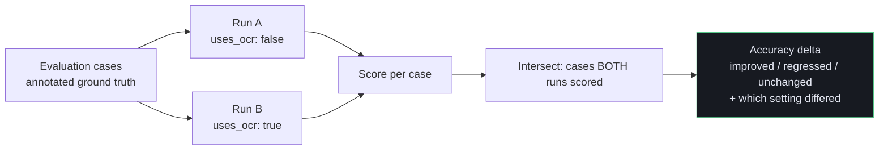

Comparisons use only the cases **both runs scored**. Comparing a run covering 50 cases against one
covering 5 would otherwise report a difference in *coverage* as a difference in *quality* — the most
likely way a benchmark quietly lies.

With exactly two runs the comparison returns an ablation delta, which is what answers "how much does
OCR actually contribute to structured extraction?" with a number instead of an assumption.

---

## 1.13 Security and operations

- **Authentication** — `AUTH_REQUIRED` off (default) accepts a bearer token *or* the `X-User-Id`
  development header. On, `X-User-Id` is ignored entirely, because a header any client can set is not
  authentication. Passwords are PBKDF2-HMAC-SHA256 with a per-user salt; tokens are HMAC-signed with
  an explicit expiry. Login answers identically for a wrong password and an unknown account.
- **Authorization** — every collection, Reel, job, search, report, and workout is scoped to the
  resolved identity. Another identity receives `404`, not `403`.
- **Rate limiting** — `RATE_LIMIT_PER_MINUTE`, disabled by default, and **per process**: with N
  workers the effective limit is N times the configured one.
- **Logging** — one JSON object per line, with the request id carried in a context variable so a line
  written deep in a service still identifies the request that caused it.
- **Metrics** — `GET /api/system/metrics/pipeline` returns per-stage run counts, failure rates,
  average and p95 latency, and models used.
- **Capabilities** — `GET /api/capabilities` derives its limitations list from actual configuration,
  so a client is never told a capability is available when it is not.

---

## 1.14 API surface

64 operations. By area:

| Area | Key endpoints |
|---|---|
| Ingestion | `POST /api/reels`, `POST /api/reels/upload`, `POST /api/reels/{id}/reprocess` |
| Jobs | `GET /api/jobs`, `/{id}/events`, `/{id}/dispatch`, `/{id}/retry`, `/{id}/cancel` |
| Knowledge | `GET /api/reels/{id}/analysis`, `POST /api/collections/{id}/index` |
| Retrieval | `POST /api/search`, `POST /api/collections/{id}/ask`, `/duplicates` |
| Reports | `GET /api/reports/collections/{id}` and `/narrative` |
| Workout | `POST /api/workouts/generate` |
| Media | `GET /api/reels/{id}/media`, `/media/{object_id}`, `POST /{id}/publish` |
| Review | `GET /api/reels/review/queue`, `POST /api/reels/{id}/review` |
| Evaluation | `/api/evaluations/cases`, `/api/evaluations/runs`, `/runs/compare` |
| System | `/health`, `/ready`, `/api/system/metrics`, `/metrics/pipeline`, `/api/capabilities` |
| Auth | `POST /api/auth/register`, `/login`, `GET /api/auth/me` |

Interactive documentation at `/docs`.

---

## 1.15 What is real, and what is not

Stated plainly, because the difference matters:

**Real and verified** — the full pipeline, graceful degradation, confidence routing, evidence
provenance, all three retrieval modes, grounded answering with citation filtering, object storage,
authentication, observability, benchmarking. 125 tests, deterministic across runs.

**Implemented but unvalidated against live models** — every Claude provider is tested through a fake
client. That pins the request shape and the grounding rules, but **not the prompts' actual quality**.
Nothing here has been measured against live model output; tuning needs a real API key and real Reels.

**Configured locally on this machine** - `.env` now runs real models: PP-OCRv4 for OCR,
distil-large-v3 on CUDA for speech, Qwen2.5-VL-3B in 4-bit for vision, BGE-M3 embeddings, and
bge-reranker-v2-m3. The *defaults* in code remain the dependency-free local paths, so a fresh clone
still runs with no weights and no API key.

**Structured output is enforced, not hoped for.** The local vision model decodes under a JSON-schema
constraint (`lm-format-enforcer`), so it can only emit tokens that keep the output a valid instance
of the schema. Free-text fields carry `maxLength` bounds - without them the model ran out of token
budget mid-sentence and produced valid-but-unfinishable JSON, which a prefix constraint alone cannot
prevent.

**A caveat that matters more than it looks.** Qwen2.5-VL-3B reports high confidence readily - 0.95
to 1.0 even on thin evidence. Confidence drives the three-tier routing, so a model that always claims
certainty makes the review queue inert. Benchmark before trusting it -
`/api/evaluations/runs/compare` exists for exactly this.

**Switching embedding provider requires a reindex.** Vector width changes (256 -> 1024) and old rows
become incompatible; the store logs how many it skipped and names the endpoint.

**Not implemented** — pose estimation (optional in the architecture), distributed rate limiting,
database migrations (no Alembic), and metrics export to Prometheus/OpenTelemetry.

---

## 1.16 Where the models live, and when they load

Models load **in order, on first use** — not all at startup, and never swapped back out. Every loader
is `lru_cache`d, so once a model is in memory it stays there for the life of the process. The peak
cost is therefore the **sum** of everything ever touched, not the largest single model.

```
JOB A  media_preparation   ffmpeg / ffprobe only        no models at all
                             |
JOB B  multimodal_analysis   |
   1. transcribe   Whisper distil-large-v3   CPU/RAM   eager, at job start
   2. ocr          RapidOCR PP-OCRv4         CPU/RAM   eager, at job start
   3. vision       Qwen2.5-VL-3B 4-bit       VRAM      lazy, inside the stage
   4. extraction   (no model)
   5. index        BGE-M3                    VRAM      at the indexing step
   6. verify       (no model)

AT SEARCH TIME (not during processing)
      rerank        bge-reranker-v2-m3        VRAM      first hybrid search only
```

Whisper and OCR load **eagerly** — their providers are built as call arguments and load weights in
`__init__`, so they are resident before the first stage runs. Qwen is **lazy**: its `__init__` only
reads settings, and `_load()` runs inside the vision stage.

Both cheap stages run on the **CPU** by configuration (`WHISPER_DEVICE=cpu`). That is the fix from
the cuDNN crash — onnxruntime and CTranslate2 ship their own CUDA libraries and fight PyTorch for the
DLL search — and it has the useful side effect that they never compete with the VLM for VRAM.

**The GPU budget on an 8 GB card:**

| Model | Precision | VRAM |
|---|---|---|
| Qwen2.5-VL-3B | 4-bit | ~3.5 GB |
| BGE-M3 | fp16 | 1.1 GB |
| bge-reranker-v2-m3 | fp16 | 1.1 GB |
| **All three resident** | | **~5.7 GB** |

The two retrieval models ship as fp32 and would take 2.2 GB each, putting the resident total at
~7.9 GB on an 8.1 GB card — with the desktop compositor also drawing on it. `RETRIEVAL_FP16`
(default on) halves them. Set it to `false` to load at full width; it is ignored without CUDA,
where fp16 would be slower rather than smaller.

The counter-intuitive consequence: **the first hybrid search after a processing run is the likeliest
moment to run out of VRAM**, not the vision stage. That is when the third model joins the two already
resident.

---

# Part 2 — Using the app

Open **`http://127.0.0.1:8000/app`** (or port 8055 if you are running the demo config).

## 2.1 Navigation map

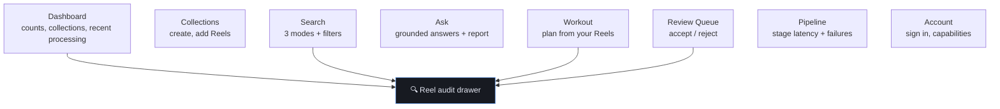

The **audit drawer** is the centrepiece. It opens from anywhere a Reel appears — a processing row, a
search result, a workout exercise, a review item — so provenance is always one click from wherever
the Reel surfaced, never a separate destination you have to navigate to.

---

## 2.2 Reading the colours

The palette carries meaning; learning it makes every screen readable at a glance.

| Colour | Means | Never means |
|---|---|---|
| **Green** | Completed, accepted, grounded | — |
| **Blue** | Active, processing, primary action | — |
| **Amber** | *A human should look* — needs review, degraded stage, ungrounded answer | "Something broke" |
| **Red** | Hard failure only | — |
| **Grey / dashed** | Skipped, or an `inferred` value | — |

Amber appears often and is **not** an error. It is the system saying it is not confident enough to
decide alone.

---

## 2.3 Dashboard

Four tiles — Total Reels, Analysed, Needs Review (amber when non-zero), Collections — then your
collections with Reel counts, then the recent processing table.

Each processing row shows the stage, a status pill, the attempt count, and an **Audit** button.
Watching `stage` move from `ingestion` → `media_preparation` → `ocr_and_transcription` →
`multimodal_analysis` → `completed` is how you follow a Reel through the pipeline.

---

## 2.4 Collections

Create a collection, then add Reels one of two ways:

- **Add a Reel by URL** records a reference only. Nothing is fetched from Instagram, so a URL-only
  Reel has no media and **cannot be analysed** — it will sit at `ingestion` forever.
- **Upload a video** is the route into the actual pipeline. Pick the `.mp4`/`.mov`/`.webm` you
  downloaded yourself (up to 100 MB); the optional URL field just records where it came from. On
  upload the Reel is queued automatically, and a **Process** button appears on the dashboard for
  anything still sitting at `ingestion`.

Where the work runs is set by `TASK_RUNNER`:

- **`local`** runs the pipeline on a background thread inside the API. No Redis, no Celery worker —
  upload a video and it is analysed automatically, one Reel at a time. Work in flight is lost if the
  process stops, but the job row survives and unfinished jobs are re-queued at startup.
- **`celery`** hands the job to a Redis-backed worker (`docker compose up redis worker`). Durable and
  scalable. If the broker is unreachable the upload still succeeds and the media is stored — the
  interface says so in a couple of seconds rather than hanging.

**View Reels** on any collection expands it in place, listing every Reel with its status, creator,
caption and any error. From there you can open the evidence drawer, retry a pending Reel, or delete
it. **Delete collection** removes the collection outright.

Both deletions are permanent and cascade: deleting a Reel also removes its transcript, OCR, visual
analysis, extracted knowledge, embeddings and downloaded media; deleting a collection does that for
every Reel inside it. The confirmation says so before anything is removed.

A collection scopes search, reports, and workout generation — keeping "AI" and "Workout" separate is what makes the topic filters and the workout
planner useful.

> The URL is recorded as a reference. Media is never fetched from Instagram; upload it yourself if
> you want the pipeline to analyse it.

---

## 2.5 Search

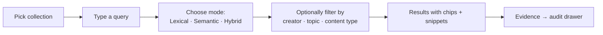

Each result shows a **match-type chip** (`lexical`, `semantic`, or `hybrid`) so you always know which
retriever produced it, plus creator and topic chips, the score, and the matching evidence snippets —
each with a blue accent bar marking it as quoted evidence rather than generated text.

**Rebuild index** re-embeds the collection. Run it after adding Reels, or after changing the
embedding provider — semantic and hybrid modes return nothing without an index.

*Try:* search `hybrid search reranking`, then switch modes and watch the ranking change. Filter by
creator `@vector_dan` or topic `fine-tuning`.

---

## 2.6 Ask

Ask a question about a collection. The answer panel shows a **Grounded** or **Not grounded** badge,
the answering model, the answer, and the sources it cited — each with its snippet and a link to the
Reel.

Ask about something the collection does not cover and it will say so explicitly rather than
improvising. That refusal is the feature, not a limitation.

Below, **Load report** aggregates the collection: topic, technology, and creator counts, plus average
extraction confidence. With no narration provider configured it returns the aggregates marked
un-narrated rather than padding them with invented prose.

---

## 2.7 Workout

Pick the collection holding exercise Reels, set days and exercises per day, optionally filter by
equipment and target muscles, then Generate.

Every exercise card shows sets × reps, equipment and muscle chips, the technique note, and — always —
**which Reel it came from**, with Evidence and Open Reel buttons. The banner states the rule: *every
exercise comes from a Reel you saved; nothing is invented.*

> **Known behaviour:** with *Allow repeats* off, the planner reuses the same top slice of exercises on
> every day, so a 2-day plan can be the same day twice while an eligible exercise goes unused. Cards
> are labelled "Repeated from an earlier day". This is the planner's existing logic, not a UI fault.

---

## 2.8 Review Queue

Reels whose extraction landed below the confidence thresholds, or whose run had a failed stage.

Each shows the creator, processing version, any error, and three actions: **Evidence** (audit
drawer), **Accept**, **Reject**. Open the evidence first — the drawer is what tells you whether the
extraction is trustworthy — then decide. Both decisions are recorded in the job event history.

---

## 2.9 Pipeline

Three tiles — Analysed Reels, Degraded Runs, Stage Runs — then the stage table: runs, succeeded,
degraded, skipped, failed, failure rate, average and p95 latency, and models used. Any non-zero
failure rate is tinted amber.

> Skipped stages never ran, so they are excluded from the failure-rate denominator. A silent Reel
> skipping transcription must not look like transcription failing.

Below, the **stage sequence** strip shows the four stages with arrows continuing *through* a failed
node — the visual statement that a failing stage does not stop the ones after it.

---

## 2.10 The audit drawer — where provenance lives

Click **Audit** or **Evidence** anywhere. You get:

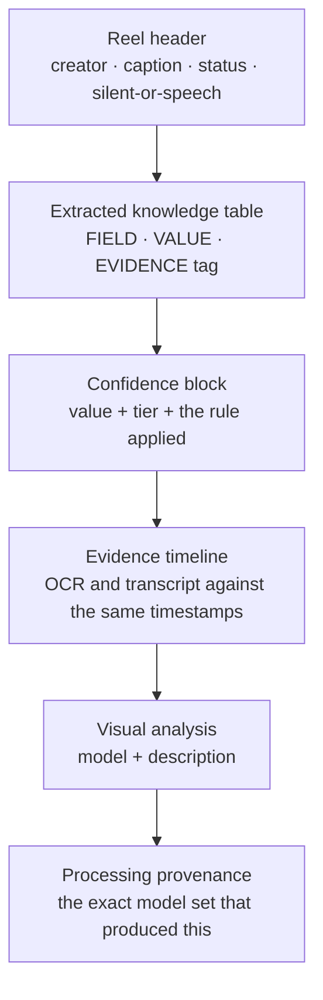

**How to read it.** Take the split-squat example:

| Field | Value | Evidence |
|---|---|---|
| exercise | Bulgarian Split Squat | `VISUAL` |
| sets | 3 | `OCR` |
| reps | 10 each leg | `OCR` |
| equipment | dumbbells, bench | `VISUAL` |
| target_muscles | quadriceps, glutes | `INFERRED` *(dashed, dimmed)* |

That table says: the movement was **seen**, the numbers were **read off the screen**, and the muscle
groups were **concluded** — so if you are going to check one row, check the dashed one.

Beside it, `0.90 · ACCEPTED · Above the 0.85 auto-accept threshold` tells you not just the score but
the decision the pipeline actually made. The tier shown always mirrors the worker's routing, so the
UI never implies a different decision than the one taken.

At the bottom, the provenance block names every model involved — so if extraction quality changes
next month, you can tell what changed.

---

## 2.11 Account

Register or sign in for a real identity; the development `X-User-Id` box greys out and is ignored
once you do. Collections are per-identity — signing in shows an empty workspace, which is the
ownership boundary working.

**Load** under Configured capabilities reports what is actually switched on, plus a candid list of
known limitations for the current configuration.

---

## 2.12 A five-minute walkthrough

1. **Collections** → create `AI` → add a Reel URL.
2. **Dashboard** → watch it appear in recent processing.
3. **Search** → pick `AI`, click **Rebuild index**, search something from the Reel, try all three modes.
4. Click **Evidence** on a result → read the evidence tags and confidence tier in the drawer.
5. **Ask** → ask a question the collection covers, then one it does not, and compare the two answers.
6. **Pipeline** → see the stage timings that run produced.
7. **Review Queue** → if anything landed there, open its evidence and accept or reject it.

---

## Further reading

- `README.md` — setup, configuration reference, and endpoint summaries.
- `IMPLEMENTATION_STATUS.md` — what was built, in order, with the reasoning behind each decision.
- `instagram_multimodal_knowledge_engine_architecture.md` — the original architecture specification.
- `/docs` — interactive OpenAPI documentation on the running app.
